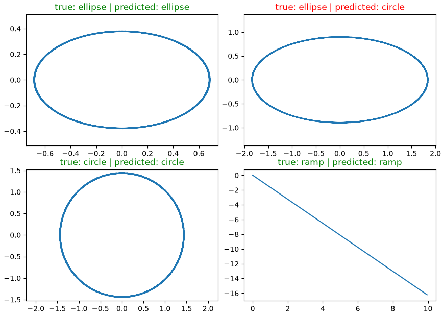

# Trajectory Generator & Classifier

Two self-directed Python projects built to strengthen my fundamentals in Python and deep learning, aimed at robotics-related roles:

1. **Trajectory Generator** — generates and visualizes different types of motion trajectories.
2. **Trajectory Classifier** — a PyTorch neural network trained to recognize which type of trajectory a given sample belongs to.

## Part 1: Trajectory Generator

A small Python project that generates and visualizes different types of motion trajectories (ramp, sinusoid, circle, ellipse), including a simple real-time animation. Built as a self-directed exercise to strengthen my Python fundamentals, inspired by trajectory generation work from a parallel ROS2 robotics project.

### Features

- Generate a linear ramp trajectory
- Generate a sinusoidal trajectory
- Generate a 2D circular trajectory
- Generate a 2D elliptical trajectory, with a live animation of a point moving along it
- Simple command-line menu to choose which trajectory to visualize

### Usage
```
python trajectory_generator.py
```

## Part 2: Trajectory Classifier

A PyTorch multi-class classifier that learns to recognize a trajectory's shape (ramp, sinusoid, circle, or ellipse) directly from its raw sampled points, reusing the generators from Part 1.

### How it works

- generates a synthetic, labeled dataset of 200 trajectories (50 per class)
- flattens each trajectory into a fixed-length feature vector, so it can be fed into a simple linear model
- trains a single-layer classifier (`nn.Linear` + `CrossEntropyLoss`) with a basic SGD training loop
- splits the data into a train set and a held-out test set, to check that the model generalizes instead of just memorizing the training examples
- the training length (number of epochs) was tuned empirically by tracking test accuracy: too few epochs underfit the data (~68% test accuracy), while training far past convergence (4500+ epochs) started to show mild overfitting, even though training accuracy was already at 100%. 800 epochs gave the best test performance.

### Results

Final model: **100% accuracy on the training set, 87.5% accuracy on the held-out test set.**

Training length was tuned empirically by tracking test accuracy across different numbers of epochs: too few epochs underfit the data, while training far past convergence showed early signs of overfitting (training accuracy stuck at 100% while test accuracy slowly degraded). 800 epochs gave the best, most stable generalization.



### Usage
```
python trajectory_classifier.py
```

## Requirements

- Python 3.x
- numpy
- matplotlib
- torch

Install dependencies with:
```
pip install numpy matplotlib torch
```